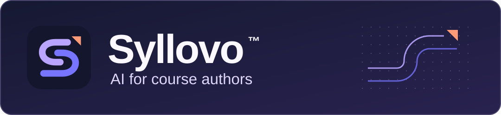

# Governed AI-Native Course Production Platform & Creator Tools

  <b>Built in India for authors, instructional designers, and learners around the world.</b> 
  Turn complex expertise into publication-ready Coursera and Pluralsight courses with governed AI.

---

## 🏛️ Ecosystem & Repositories

| Repository | Purpose | Visibility | Status |
| :--- | :--- | :--- | :--- |
| [**`syllovo-creator-hub`**](https://github.com/syllovo/syllovo-creator-hub) | Internal Technical Documentation Portal, Camtasia/Snagit SOPs, ElevenLabs Voice Studio, and Creator Workbench. | `Private` | Deployed to [Cloudflare Pages](https://syllovo-creator-hub.pages.dev) |
| [**`syllovo-core`**](https://github.com/syllovo/syllovo-core) | The central governed course authoring engine: brief-to-outline, demo project synthesis, slide decks, and multi-track narration. | `Private` | Active Platform |
| [**`syllovo-skills-pluralsight`**](https://github.com/syllovo/syllovo-skills-pluralsight) | Governed authoring skills, curriculum validators, and screen-highlight specialists for Pluralsight production. | `Private` | Active Releases |
| [**`.github`**](https://github.com/syllovo/.github) | Organization profile, community health files, and brand standards. | `Public` | Active |

---

## 🎯 Mission & Vision

- **Mission**: Empower subject-matter experts and enterprise learning teams to transform raw technical knowledge into world-class courses with traceable versions, human review gates, and studio-grade audio/video delivery assets.
- **Vision**: Build one of the world's premier AI course authoring ecosystems from India, enabling creators to build sustainable educational careers and learners to master job-ready skills.

---

## 🛠️ Production Standards Quick Reference

- **Video Delivery Specs**: 1080p60 MP4, H.264 High Profile, CBR 12–15 Mbps, 48kHz AAC Audio.
- **Audio Standards**: Integrated Loudness **-14.0 LUFS** (±1.0), True Peak max **-1.0 dBTP**, ElevenLabs Multilingual v2 calibration (`Stability: 0.55`, `Similarity: 0.80`, `Style: 0.00`).
- **Screen Recording**: TechSmith Camtasia macOS 3-Track Standard, 150% cursor scaling, 50% Gaussian blur for UI layout hints vs 100% flat solid `#0F172A` masking for credentials.

---

  © 2026 Syllovo. All rights reserved. • Inquiries: <a href="mailto:rupesh@fullstackmaster.net">rupesh@fullstackmaster.net</a>

